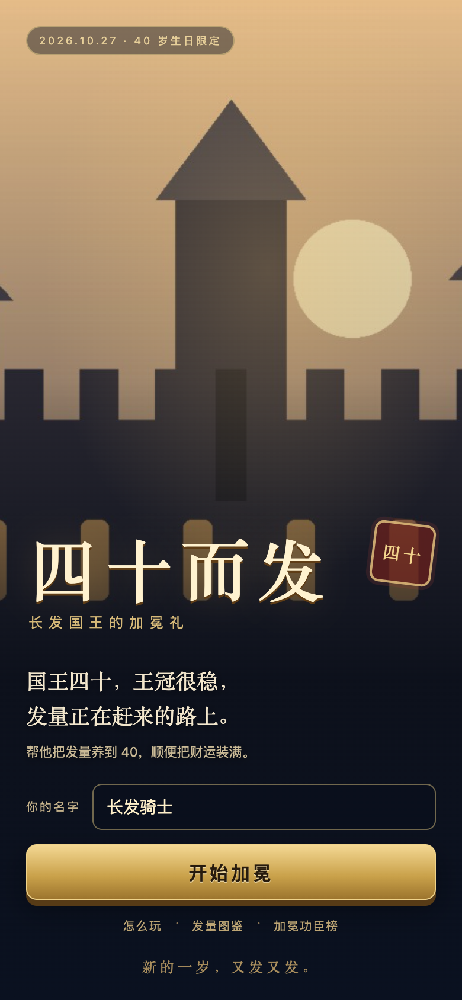

# Forty and Hair

A small, polished canvas merge game built as a 40th-birthday gift. Combine hair pieces, grow the king's hair to 40, collect red-packet bonuses, and compete on a shared real-time leaderboard.

**Live demo:** https://forty-hair.pages.dev/

> The live demo contains private birthday artwork. This repository ships with generated placeholder artwork so the project can be published safely.



## Features

- Canvas-based merge game with drag-to-aim and drop controls.
- Nine hair tiers, combo bonuses, red-packet bursts, and a crown-line lose condition.
- Four unlockable story cards at 10, 20, 30, and 40 hair.
- Nickname-based local player identity, so different names in the same browser keep separate scores.
- Shared leaderboard backed by Cloudflare D1, refreshed every 4 seconds while open.
- Deterministic ranking: score, then hair, then earliest submission.
- Local fallback board when the API is unavailable.
- Procedural Web Audio soundtrack and sound effects; no external audio files.
- Responsive mobile-first layout with large touch targets.

## Tech stack

- **Frontend:** vanilla HTML, CSS, and JavaScript; Canvas 2D; Web Audio.
- **Hosting:** Cloudflare Pages.
- **API:** a single Cloudflare Pages Function at `functions/api/[[path]].js`.
- **Database:** Cloudflare D1 (SQLite).
- **No build step** and no frontend framework.

## Project structure

```text
.
├── public/                  # Static game
│   ├── index.html
│   ├── app.js
│   ├── style.css
│   ├── music.js
│   └── assets/              # Generated placeholder artwork
├── functions/
│   └── api/
│       └── [[path]].js      # /api/health, /api/leaderboard, /api/score
├── schema.sql               # D1 schema and ranking index
├── wrangler.toml            # Pages + D1 configuration
├── package.json
└── LICENSE
```

## Run locally

Requirements: Node.js 18+ and a Cloudflare account for remote deployment.

```bash
npm install

# Create the local D1 table on first run.
npx wrangler d1 execute forty-hair-leaderboard --local --file=schema.sql

npm run dev
```

Open the URL printed by Wrangler. The Pages Function and D1 binding are served together, so the game and API share an origin.

If you only want to preview the static game without the leaderboard, serve the `public/` directory with any static file server. The game detects the missing API and falls back to a local board.

## Deploy to Cloudflare Pages

1. Create a D1 database:

   ```bash
   npx wrangler d1 create forty-hair-leaderboard
   ```

2. Copy the returned database ID into `wrangler.toml`:

   ```toml
   database_id = "YOUR_D1_DATABASE_ID"
   ```

3. Apply the schema to the remote database:

   ```bash
   npx wrangler d1 execute forty-hair-leaderboard --remote --file=schema.sql
   ```

4. Create the Pages project once, then deploy:

   ```bash
   npx wrangler pages project create forty-hair --production-branch=main
   npm run deploy
   ```

   The deploy command uploads `public/` and bundles the Pages Function. The D1 binding is read from `wrangler.toml`.

5. Open the production URL shown by Wrangler (`https://<project>.pages.dev`).

## API

All endpoints are same-origin JSON.

| Method | Path | Description |
| --- | --- | --- |
| `GET` | `/api/health` | Health check and D1 connectivity. |
| `GET` | `/api/leaderboard?limit=10&clientId=...` | Top scores. `mine` marks the caller's row. |
| `POST` | `/api/score` | Submit a run. |

Example submission:

```bash
curl -X POST http://localhost:8788/api/score \
  -H 'content-type: application/json' \
  -d '{"clientId":"demo-player-001","name":"Demo","score":3280,"hair":40,"title":"Chief Hair Officer"}'
```

`clientId` must be 8-64 characters from `[A-Za-z0-9_-]`. Names are limited to 8 characters, titles to 24, and hair to 0-40. The API is intentionally lightweight and casual; it is not an anti-cheat system.

## Data model

```sql
CREATE TABLE scores (
  client_id TEXT PRIMARY KEY,
  name TEXT NOT NULL,
  score INTEGER NOT NULL,
  hair INTEGER NOT NULL,
  title TEXT NOT NULL DEFAULT '',
  created_at INTEGER NOT NULL
);
```

A player's row is updated only when the new `(score, hair)` pair is better than the stored pair. Ties are broken by `created_at` ascending.

## Customization

- **Copy and birthday date:** edit `public/index.html` and the `DOCS` array in `public/app.js`.
- **Player names:** the game stores a generated ID per nickname in `localStorage`.
- **Game balance:** see `TIERS`, `W`, `H`, and the scoring functions near the top of `public/app.js`.
- **Theme:** colors and typography live in `public/style.css`.
- **Artwork:** replace the files in `public/assets/` with your own images. Keep the same filenames or update the references in `index.html`, `style.css`, and `app.js`.

## Privacy

The game has no analytics, accounts, or third-party trackers. Nicknames and personal bests are stored in `localStorage`; the leaderboard stores the nickname, score, hair count, title, and timestamp in D1. Do not enter sensitive information as a nickname.

## License

The code and the generated placeholder artwork in this repository are released under the [MIT License](LICENSE).

The original birthday portraits and other private artwork used by the live demo are **not** included in this repository and are not covered by the MIT License.
